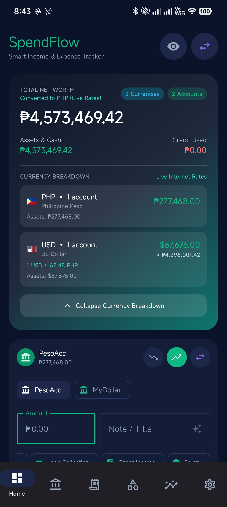
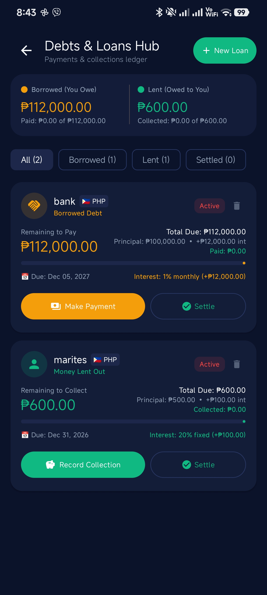
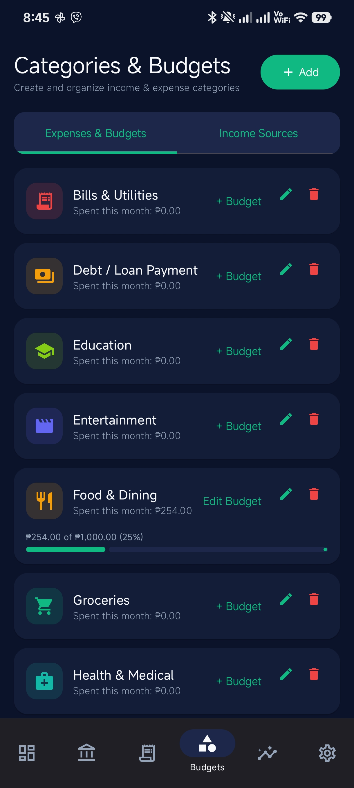
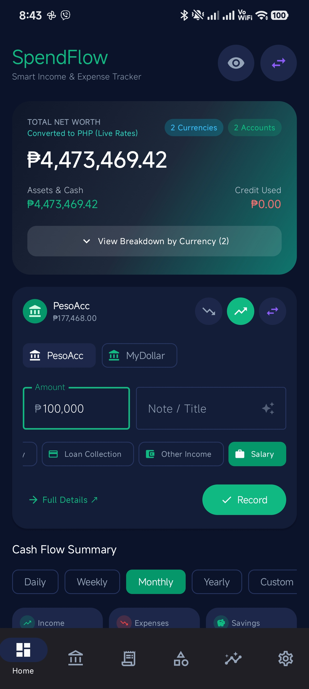

# SpendFlow 💳 📊 (v1.1)

DISCLAIMER: APP BUILT WITH Google aistudio

SpendFlow is a modern, privacy-first personal finance and expense tracking Android application built with **Kotlin** and **Jetpack Compose (Material 3)**. It features an intelligent **50-30-20 income-based auto-adjusting budget**, multi-currency account management, credit card billing cycle tracking with variable cutoff date calculations, an interactive debts & loans ledger with interest calculations, dynamic keyword learning and transaction history matching, and real-time net worth conversion.

---

## 📱 App Screenshots

| 🏠 Dashboard & Multi-Currency | 🤝 Debts & Loans Hub |
| :---: | :---: |
|  |  |
| *Live exchange rate net worth conversion & accounts overview* | *Active loans with interest rates, native currency & payment ledger* |

| 📊 50-30-20 Auto Budget & Categories | ✍️ Transaction Recording & History Matching |
| :---: | :---: |
|  |  |
| *50/30/20 auto-adjusting shared budget bars & category buckets* | *History matching, dynamic keyword learning & MRU pickers* |

| 💳 Credit Card Statement Cycles | ⚡ Quick In-App Transaction Widget |
| :---: | :---: |
|  |  |
| *UnionBank variable cutoff date calculation & payment reminders* | *Instant widget for recording expenses/incomes in 1 tap* |

| 🏷️ Multi-Category Selection Prompt | 📂 Database Backup & CSV Reports |
| :---: | :---: |
|  |  |
| *Disambiguation prompt when note matches multiple categories* | *Full database JSON backup, CSV export & import capabilities* |

---

## 🚀 For Users: How to Test the App

If you are a tester or user and want to evaluate SpendFlow:

### 1. Download the APK
- Download the pre-built debug APK directly from the repository root:
  - **File:** `SpendFlow-debug.apk` (Version 1.1)
  - Also available via the top-right Settings menu (**Export / Download APK/AAB**).
- Or transfer it to your Android device via USB/Drive.

### 2. Install on Android Device / Streaming Emulator
1. Enable **Install from Unknown Sources** in your Android device settings if prompted.
2. Open `SpendFlow-debug.apk` on your device (Android 7.0 / API 24+ recommended).
3. Tap **Install** and launch **SpendFlow**.

### 3. Key Test Flows & Things to Try

- **50-30-20 Income-Based Auto-Adjusting Budget**:
  1. Open the **Categories & Budgets** tab.
  2. Notice the live 50-30-20 overview: **Needs (50%)**, **Wants (30%)**, and **Savings & Debt (20%)**.
  3. Record an Income transaction for your 1st cutoff salary (e.g., ₱30,000).
     - Limits auto-divide: Needs = ₱15,000, Wants = ₱9,000, Savings & Debt = ₱6,000.
  4. Record an expense (e.g. ₱8,000 groceries under Needs).
  5. Record a 2nd cutoff salary on the 15th (e.g., +₱30,000 → Total ₱60,000):
     - The limits automatically expand (Needs = ₱30,000, Wants = ₱18,000, Savings & Debt = ₱12,000) while your existing spent amount stays at ₱8,000!
  6. **Transfer Rules**:
     - Transfer funds to a **Savings** account: automatically counts towards the **Savings & Debt (20%)** bucket.
     - Transfer funds to a **Credit Card** account: automatically excluded (since individual card purchases are already categorized under Needs/Wants).
     - Pay a loan: automatically counts towards **Savings & Debt (20%)**.
  7. Check the **Dashboard** to see the 50/30/20 budget snapshot card with live progress bars.

- **Dynamic Keyword Learning & History Matching**:
  1. Add a transaction with a unique store or vendor name in the title or note (e.g. `"Decathlon running shoes"` under Shopping).
  2. Next time you record `"Decathlon"`, SpendFlow remembers your vendor history and automatically suggests or preselects Shopping.
  3. If your note matches multiple categories, a quick multi-category selection dialog appears so you can pick the right one in one tap.

- **Most Recently Used (MRU) Picker Ordering**:
  1. When selecting an account or category in the quick transaction widget or full transaction sheet, the last selected item moves to the 1st position, streamlining frequent entries.

- **Credit Card Billing Cycles & Variable Cutoff Dates**:
  1. Add a Credit Card account in the Accounts tab.
  2. Select **Variable / UnionBank Style** statement date (e.g. base day 18).
  3. Notice how SpendFlow calculates exact cutoff dates based on month length (31-day months: 18th; 30-day months: 17th; February: 15th).
  4. View upcoming statement cutoffs and payment grace periods on the Dashboard and Accounts screen.

- **Multi-Currency Net Worth**:
  1. Create accounts in different currencies (e.g. `PHP`, `USD`, `EUR`, `JPY`).
  2. Notice the **Total Net Worth** card on the Dashboard: in collapsed mode, all balances are converted to your primary currency using real-time rates.
  3. Tap **Extend** to view exact balances by individual currency.
  4. Switch your **Primary Currency** in Settings to recalibrate all metrics.

- **Debts & Loans Hub**:
  1. Tap **New Loan** (record money borrowed or lent). Add an interest rate (e.g. 5% monthly or annual).
  2. Verify that interest is factored into total due and remaining balances.
  3. Record payments or collections with ledger sync.

- **Safe Category Deletion**:
  1. Attempt to delete a category with recorded transactions.
  2. SpendFlow offers to safely **reassign** all transactions to another category before deleting, preventing orphaned records.

---

## 💻 For Developers: Getting Started

### Tech Stack & Architecture
- **Language**: Kotlin 2.2+
- **UI Framework**: Jetpack Compose (Material 3 Design System)
- **Local Persistence**: Room 2.7.0 (Database Version 6 with migrations `MIGRATION_4_5`, `MIGRATION_5_6`)
- **Architecture**: MVVM + Repository pattern with Kotlin Coroutines & `StateFlow`
- **Networking**: OkHttp 4.10 + Moshi for real-time exchange rate fetching (`open.er-api.com`)
- **Key-Value Store**: AndroidX DataStore Preferences for user settings
- **Security / Auth**: AndroidX Biometric 1.2.0-alpha05
- **Build System**: Gradle 9+ (Kotlin DSL `.gradle.kts`) with Version Catalog (`libs.versions.toml`)

### Directory Structure
```
SpendFlow/
├── app/
│   ├── src/main/java/com/example/
│   │   ├── data/
│   │   │   ├── local/            # Room Entities, DAOs, AppDatabase & Migrations
│   │   │   ├── model/            # Account, Transaction, Category & BudgetGroup models
│   │   │   └── repository/       # FinanceRepository
│   │   ├── ui/
│   │   │   ├── components/       # Reusable M3 Composables, Dialogs, Pickers, Widgets
│   │   │   ├── screens/          # Dashboard, Categories, Loans, Accounts, Reports
│   │   │   └── theme/            # Material 3 Color Schemes & Typography
│   │   └── util/                 # Budget503020Service, CategoryMatchingService,
│   │                             # ExchangeRateService, LoanUtils, DateUtils, CsvUtils
│   └── src/main/res/             # Strings, XML Drawables, Icons
├── gradle/                       # Version catalog (libs.versions.toml) & wrapper
├── screenshots/                  # High-resolution application screenshots
├── SpendFlow-debug.apk           # Pre-built testing APK (v1.1)
└── README.md                     # Documentation
```

### Prerequisites
- **Android Studio Ladybug / Meerkat** or newer.
- **JDK 17** (or JDK 21).
- **Android SDK** API Level 36 (`minSdk = 24`, `targetSdk = 36`).

### Setup & Build Instructions

1. **Clone the Repository**:
   ```bash
   git clone https://github.com/markpace2023/pera-pera.git
   cd spendflow
   ```

2. **Configure Environment Secrets**:
   - Copy the sample environment file:
     ```bash
     cp .env.example .env
     ```

3. **Build the Debug APK**:
   ```bash
   gradle assembleDebug
   ```
   The compiled APK will be located at:
   `app/build/outputs/apk/debug/app-debug.apk` and copied to `SpendFlow-debug.apk`.

4. **Run Local Unit Tests**:
   ```bash
   gradle :app:testDebugUnitTest --tests com.example.ExampleUnitTest
   ```

---

## ✨ Features Breakdown

### 1. 50-30-20 Income-Based Auto-Adjusting Budget
<p align="center">
  
</p>

- **Live Auto-Adjustment**: Limits dynamically scale with total monthly income.
- **Shared Category Pools**: Categories are grouped into **Needs (50%)**, **Wants (30%)**, and **Savings & Debt (20%)**.
- **Smart Transfer Accounting**: Transfers to savings accounts count as savings; credit card transfers are excluded; loan repayments count towards savings & debt.
- **Visual Progress Tracking**: Multi-segment ratio bars and dedicated progress cards for each bucket.

---

### 2. Multi-Currency Accounts & Global Net Worth
<p align="center">
  
</p>

- **Native Currencies**: Set native currencies per account (PHP `₱`, USD `$`, EUR `€`, JPY `¥`, GBP `£`, CAD, AUD, SGD, etc.).
- **Live Rate Conversion**: Real-time net worth conversion with multi-currency breakdown accordions.
- **Settings Default Currency**: Switch primary currency anytime with automatic recalibration.

---

### 3. Debts & Loans Hub (Ledger)
<p align="center">
  
</p>

- **Lending & Borrowing**: Track liabilities and receivables with native currencies.
- **Interest Calculations**: Fixed, monthly, or annual interest computed directly into remaining balances.
- **Payment Ledger**: Partial payment and collection tracking with one-tap quick chips.

---

### 4. Credit Card Statement Cycles & Variable Cutoff Dates
<p align="center">
  
</p>

- **Variable Month-Length Calculation (UnionBank style)**: Automatically adjusts cutoff dates in 30-day months and February.
- **Fixed & Relative Cycle Types**: Support for fixed calendar day or days-before-month-end cutoffs.
- **Payment Grace Periods**: Live indicators showing days remaining until statement cutoff and due date.

---

### 5. Dynamic Keyword Learning & History Matching
<p align="center">
  
</p>

- **Dynamic Keyword Learning**: Learns vendor and store names from your saved transactions.
- **History Matching**: Exact matching by past transaction titles and notes.
- **Disambiguation Dialog**: Lets you choose when multiple categories match a note.
- **MRU Ordering**: Most recently used accounts and categories appear first.

---

### 6. Quick In-App Transaction Widget
<p align="center">
  
</p>

- **One-Tap Recording**: Quick widget directly on the Dashboard for immediate entry.
- **Inline Category Addition**: Add missing categories directly without leaving the quick entry flow.

---

### 7. Database Backup & CSV Analytics
<p align="center">
  
</p>

- **Full JSON Database Backup**: Complete backup and restore including accounts, categories, transactions, and budgets.
- **CSV Export & Import**: Export clean CSV reports for external spreadsheets.
- **Biometric App Lock**: Optional biometric protection for financial privacy.

---

## 🐛 Known Limitations & Notes

1. **Exchange Rates Offline Fallback**: Live exchange rates require internet access (`open.er-api.com`). When offline, cached fallback rates are used.
2. **Offline Robolectric Shadows**: Local unit testing uses pure JVM unit tests in `ExampleUnitTest.kt` to avoid network dependency on external Maven SDK shadow jars in offline containers.
3. **Room Database Migrations**: Seamless SQLite migrations (`MIGRATION_4_5`, `MIGRATION_5_6`) ensure user data is preserved across schema updates.

---

## 📄 License
This project is open-source under the [MIT License](LICENSE).
