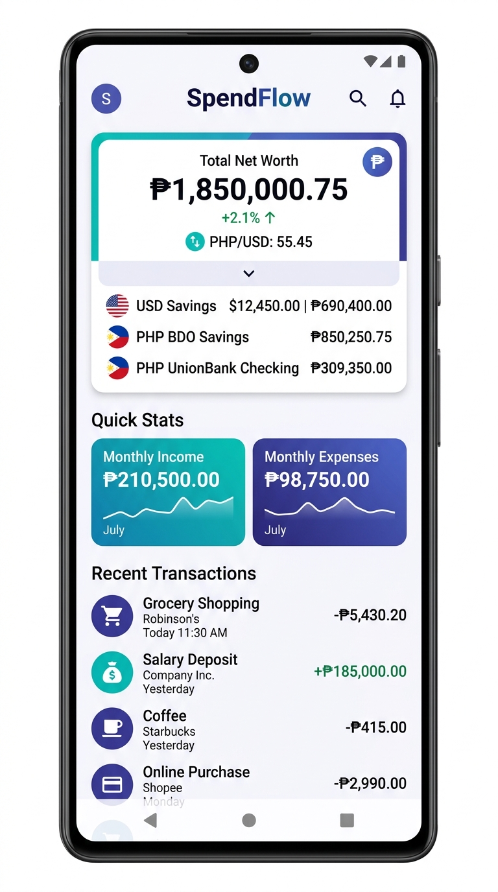
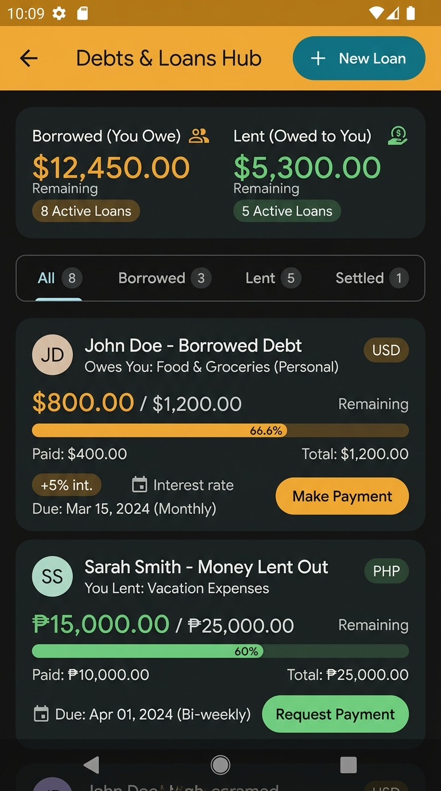
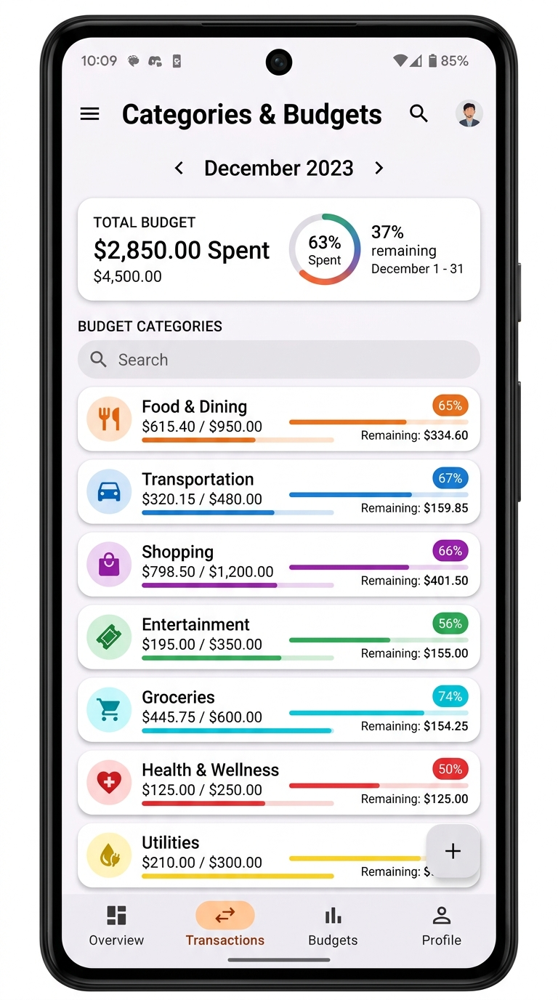
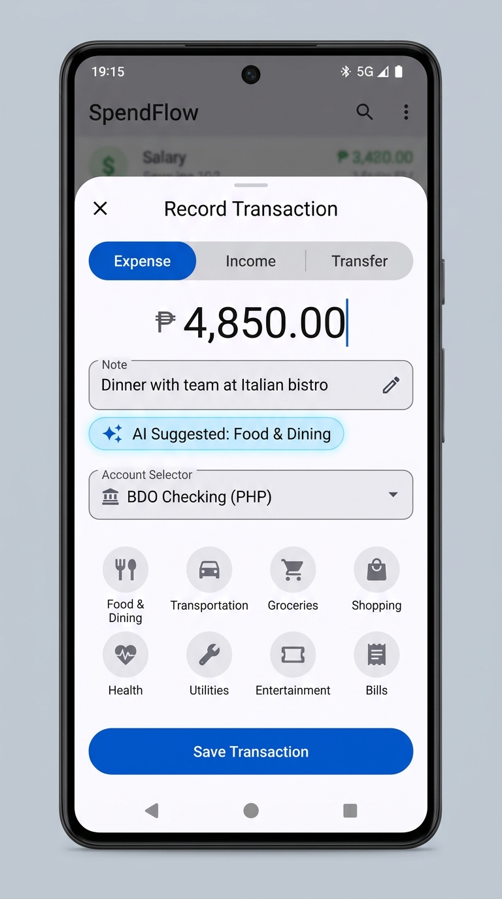

# SpendFlow 💳 📊

SpendFlow is a modern, privacy-first personal finance and expense tracking Android application built with **Kotlin** and **Jetpack Compose (Material 3)**. It offers multi-currency account management, an intelligent debts & loans ledger with interest calculations, AI-powered category suggestions, and real-time net worth conversion.

---

## 📱 App Screenshots

| 🏠 Dashboard & Multi-Currency | 🤝 Debts & Loans Hub |
| :---: | :---: |
|  |  |
| *Live exchange rate net worth conversion & accounts overview* | *Active loans with interest rates, native currency & ledger* |

| 🏷️ Categories & Budgets | ✍️ Transaction Recording & AI |
| :---: | :---: |
|  |  |
| *Visual budget tracking & orphan-safe category management* | *✨ AI smart suggestions & reset category state* |

---

## 🚀 For Users: How to Test the App

If you are a tester or user and just want to run and evaluate SpendFlow:

### 1. Download the APK
- Download the pre-built debug APK directly from the repository root:
  - **File:** `SpendFlow-debug.apk`
- Or transfer it to your Android device via USB/Drive.

### 2. Install on Android Device / Emulator
1. Enable **Install from Unknown Sources** in your Android device settings if prompted.
2. Open `SpendFlow-debug.apk` on your device (Android 7.0 / API 24+ recommended).
3. Tap **Install** and launch **SpendFlow**.

### 3. Key Test Flows & Things to Try
- **Multi-Currency Net Worth**:
  1. Open the **Accounts** tab or drawer and create a second account in a foreign currency (e.g. `USD` or `EUR`).
  2. Notice the **Total Net Worth** card on the Dashboard: in collapsed mode, it converts all foreign balances to your primary currency using live exchange rates.
  3. Tap the **Extend / Expand** button on the card to see balances broken down by individual native currencies.
  4. Go to **Settings** and switch your **Primary Currency** (e.g., from `PHP` to `USD` or `EUR`) to see all summaries immediately recalibrated.
- **Transactions & Clean Category State**:
  1. Tap the `+` FAB or Quick Add button.
  2. Add an expense or income transaction with a category.
  3. Immediately open the transaction sheet again: verify that no previous category lingers selected.
- **AI-Powered Category Suggestion**:
  1. Enter a note like `"Dinner with team at Italian bistro"`.
  2. Notice the instant `✨ AI Suggested: Food & Dining` pill.
  3. Tap the suggestion to select it with one tap.
- **Category Deletion Safety Check**:
  1. Go to **Categories & Budgets**.
  2. Attempt to delete a category that already has recorded transactions.
  3. Verify that the safety dialog pops up, offering to **reassign** all recorded transactions to another category or **cancel** deletion.
- **Debts & Loans Hub**:
  1. Go to the **Debts & Loans Hub** from the dashboard or side drawer.
  2. Tap **New Loan** (record money borrowed or lent). Add an interest rate (e.g., 5%).
  3. Verify that the interest is included in the total due and remaining balance.
  4. Check that the loan honors its account currency (with a country flag pill).
  5. Tap **Make Payment** or **Record Collection** to record a payment into the ledger. Quick chips ("Full", "Half") will calculate dynamic amounts based on the paying account's currency.

---

## 💻 For Developers: Getting Started

### Tech Stack & Architecture
- **Language**: Kotlin 2.2+
- **UI Framework**: Jetpack Compose (Material 3 Design System)
- **Local Persistence**: Room 2.7.0 (with KSP code generation)
- **Architecture**: MVVM + Repository pattern with Kotlin Coroutines & `StateFlow`
- **Networking**: OkHttp 4.10 + Moshi for real-time exchange rate fetching (`open.er-api.com`)
- **Key-Value Store**: AndroidX DataStore Preferences for user settings
- **Security / Auth**: AndroidX Biometric 1.2.0-alpha05
- **Build System**: Gradle 9+ (Kotlin DSL `.gradle.kts`) with Version Catalog (`libs.versions.toml`)

### Directory Structure
```
SpendFlow/
├── app/
│   ├── src/main/java/com/example/
│   │   ├── data/                 # Room Entities, DAOs, AppDatabase, Repository
│   │   ├── ui/
│   │   │   ├── components/       # Reusable M3 Composables, Dialogs, BottomSheets
│   │   │   ├── screens/          # Dashboard, Loans, Categories, Reports, Main
│   │   │   └── theme/            # Material 3 Color Schemes & Typography
│   │   └── util/                 # LoanUtils, ExchangeRateService, CurrencyUtils
│   └── src/main/res/             # Strings, XML Drawables, Icons
├── gradle/                       # Version catalog (libs.versions.toml) & wrapper
├── screenshots/                  # High-resolution application screenshots
├── SpendFlow-debug.apk           # Pre-built testing APK
└── README.md                     # Documentation
```

### Prerequisites
- **Android Studio Ladybug / Meerkat** or newer.
- **JDK 17** (or JDK 21).
- **Android SDK** API Level 36 (`minSdk = 24`, `targetSdk = 36`).

### Setup & Build Instructions

1. **Clone the Repository**:
   ```bash
   git clone https://github.com/markpace2023/pera-pera.git
   cd spendflow
   ```

2. **Configure Environment Secrets**:
   - Copy the sample environment file:
     ```bash
     cp .env.example .env
     ```
   - If using AI features, insert your Gemini API Key in `.env`:
     ```properties
     GEMINI_API_KEY=your_gemini_api_key_here
     ```

3. **Build the Debug APK**:
   ```bash
   gradle assembleDebug
   ```
   The compiled APK will be located at:
   `app/build/outputs/apk/debug/app-debug.apk`

4. **Run Local Unit Tests**:
   ```bash
   gradle :app:testDebugUnitTest
   ```

---

## ✨ Features Breakdown

### 1. Multi-Currency Accounts & Global Net Worth
<p align="center">
  
</p>

- **Account Currencies**: Set a native currency for every wallet or bank account (e.g., PHP `₱`, USD `$`, EUR `€`, JPY `¥`, GBP `£`, CAD, AUD, SGD).
- **Settings Primary Currency**: Choose a global default reporting currency in Settings.
- **Collapsible Dashboard Net Worth**:
  - **Collapsed View**: Aggregate net worth converted to your primary currency using real-time rates.
  - **Expanded View**: Expandable accordion detailing exact balances by distinct currency.
- **Cross-Currency Indicators**: Transactions recorded in secondary currencies show live converted approximations in your primary currency.

---

### 2. Debts & Loans Hub (Ledger)
<p align="center">
  
</p>

- **Lending & Borrowing Tracking**: Track both money borrowed (liabilities) and money lent out (receivables).
- **Interest Inclusion**: Fixed and percentage interest calculations factored directly into remaining balances and total expected amounts.
- **Multi-Currency Loan Support**: Loans retain the original currency of the account with flag pills; cross-currency payments automatically convert using live exchange rates.
- **Payment Ledger**: Complete transaction history for partial payments and collections with instant account balance synchronization.
- **Settlement Status**: Mark loans as settled or reopen them at any time.

---

### 3. Categories & Safe Budgeting
<p align="center">
  
</p>

- **Category Customization**: Color-coded categories with Material Symbols.
- **Spending Budgets**: Set spending limits per category with visual progress tracking.
- **Orphan Prevention on Delete**: When removing a category with linked transactions, SpendFlow prompts to reassign transactions to an alternative category or abort.

---

### 4. Transaction Management & AI Categorization
<p align="center">
  
</p>

- **Transaction Types**: Expense, Income, and Internal Account Transfers.
- **AI Category Suggestions**: Smart heuristics and AI suggestions for transaction titles, with one-tap creation for missing categories.
- **Clean Input State**: Automatically resets active selection upon recording to prevent category bleed across entries.
- **Transaction Filters & History**: Search by keyword, filter by account, category, or date range.

---

### 5. Transfers & Cash Flow Analytics
- **Account Transfers**: Move funds between accounts with single-action debit and credit entries.
- **Reports & Charts**: Visual breakdown of spending by category, cash flow over time, and net monthly savings.
- **Biometric App Lock**: Optional biometric authentication (fingerprint/face) for added privacy.

---

## 🐛 Known Limitations & Current Issues

1. **Exchange Rates Offline Fallback**:
   - Live exchange rates require an internet connection (`open.er-api.com`). If offline, static cached baseline rates are used until connectivity is restored.
2. **Historical Cross-Currency Loan Payments**:
   - When paying a loan using an account in a different currency, the conversion is calculated using the exchange rate active at payment time. Historical daily FX fluctuations between original loan issuance and settlement are not tracked separately.
3. **Room Database Destructive Migration**:
   - The app database is currently configured with `fallbackToDestructiveMigration()` for development speed. Future production releases will require explicit Room migration scripts.
4. **Compose Compiler Deprecation Warnings**:
   - Build logs show minor compile-time deprecation warnings for select Material icons (e.g. `TrendingUp` vs `Icons.AutoMirrored.Filled.TrendingUp`) and `Divider` vs `HorizontalDivider`. These do not affect functionality or runtime performance.

---

## 📄 License
This project is open-source under the [MIT License](LICENSE). Contributions, issues, and feature requests are welcome!
